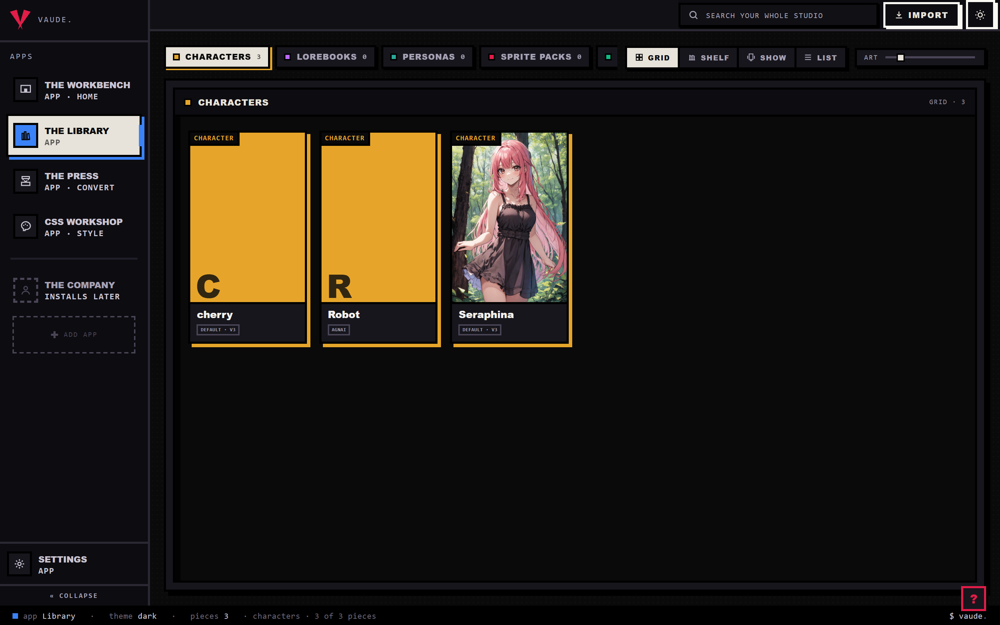

# Browse the Library

The Library is the shelves: every piece in your studio, sorted onto decks by kind, shown however you want to look at them. This page covers browsing once your pieces are already there, the two layouts, the views on offer, and staging one piece or a batch over to the Workbench. For how pieces land here in the first place, see Import a file.

## The short version

1. **Pick a layout.** The switch at the top of the rail on the left: Carousel runs each deck in one row that scrolls sideways; Grid lets the cards wrap.
2. **Pick a deck.** Click a deck in the rail: Characters, Lorebooks, Personas, Packs, Presets, Regex sets, or Quick replies. Each carries a live count. The click shows that deck alone; click it again to see every deck.
3. **Stage what you want.** Click a piece (in Show, click its Stage for the Workbench button) to add it to the tray, accent ring, corner check. Click it again to drop it. Shift-click stages everything between two pieces, even across decks while every deck shows. The tray stays full as you move around, so a persona and two characters can travel together.
4. **Send it to the Workbench.** The send bar's button reads Send it to the Workbench for one piece, or Send all 3 to the Workbench for a batch. Right-click a single piece instead to send it without staging first, or to stage it for the Press.

> Screenshot needed: the Library with every deck showing, the rail on the left and the Characters and Presets rows.

## The shelves

Each deck that holds anything gets its own numbered section of cards. In Carousel the cards run in one row that scrolls sideways; drag the bar under a row, or click along it, to move through a long deck. In Grid they wrap, and you can drag a box across them to stage several at once. The art slider in the top bar makes every card larger or smaller, down to small tiles that show just the art, the name, the on/off switch, and the ... menu. The cards say what the studio knows: a character or persona is a tall portrait card with its name and tagline, a preset shows the sampler values it carries and how many prompts it has, a lorebook shows its entry count on a book cover, and a regex set how many of its rules are on and what they do.

Each card carries its own tools. A lorebook or regex set has an on/off switch (an off one is skipped on export), Split, and Copy; drag one onto another of the same kind to merge them. The ... menu (or a right-click) always has them too, so a small tile loses none of them. A regex set flags rules that may run slowly. A persona shows whether it is your default, its pronouns, and how many sections it has. Each row ends in a New tile. The date on a card is when the piece was imported. The ... button on a card opens the same menu as a right-click.

The search box above the shelf finds a piece by its name, its id, a lorebook's keywords, its tags, or where it came from, across every deck at once.

All and Recent above the shelf set the order: All is your studio's order (or best match first while you search), Recent puts the newest first, counting both when a piece arrived and when you last opened it.

## Each deck's views

@fig views

Every deck in the rail shows even when it holds nothing, count 0, so you always see the full shape of your studio, not just whatever happens to have pieces in it right now. The status line at the bottom of the room says how much of that shape you're looking at, "characters · 4 of 12 pieces" with one deck showing, "every deck · 12 of 12 pieces" with all of them. An empty deck only appears when you pick it in the rail, where its shelf offers a way to start. Every deck you can start from scratch, Characters, Lorebooks, Regex sets, Personas, Presets, and Quick replies, offers New on its section and a New tile at the end of its row; Packs are import-only, no blank start.

Every section's header has its own view switch, and each deck remembers its own choice: Cards first, then Tiles, Show, and List, which behave the same on every deck: Tiles is the wall of small portrait cards, Show is one piece at a time with its own tagline and description, List is dense rows for a big collection. Shelf also runs everywhere, spine cards with a name, key, or tag search box, but Lorebooks and Regex sets get their own reason to reach for it: a Lorebook spine carries an on/off switch, Split, Copy, and drag-to-merge onto another book; a Regex set's Sets view adds its rule count, a computed one-line description of what the set does, and a quiet flag for rules it reads as slow. Turning a book or a set off is not cosmetic, an off one is skipped on export.

> Screenshot needed: the Lorebooks deck in Shelf view, one spine card showing its on/off switch, entry count, and the Split and Copy buttons.

## Staging and sending

Tapping a piece anywhere in the Library stages it, it doesn't open it. A staged piece wears an accent ring; a piece already open on the Workbench wears a quiet "on the workbench" tag instead, and tapping that one just repeats the tag back to you rather than toggling anything. The tray survives switching decks and layouts, so you can pick a character from one deck and a lorebook from another before you send anything.

The send bar only appears once something is staged. It carries the live count, "3 pieces staged", the Send button described above, and a Clear button that empties the tray without sending. Sending opens every staged piece as its own tab and, depending on your Workbench follow setting (changeable in Settings), may take you there right away.

You don't have to stage anything to move a single piece. Right-click it and choose Send to the Workbench to open it immediately, or Stage for the Press to queue it for export instead, a separate queue from this tray, covered in Convert a card.

## Tips

- A piece already open on the Workbench can't be re-staged. Tapping it just tells you it's already there.
- The staged tray persists across deck, layout, and view switches; it only empties when you send it or click Clear.
- Collections sit in the rail under the decks. Clicking one filters the shelf, the same as its chip in the groups bar; click it again to stop.
- On a narrow window the rail folds into a row of deck chips above the shelf.
- Switch to a deck your current view doesn't support and it falls back to Cards, not whatever you had picked before.
- The Shelf view's search box narrows what's on screen. It doesn't touch the deck's count in the rail or the deck's actual total.
- Personas get their own view, Profiles, beside the plain Shelf: each persona with its brief, pronouns, and sections, the default marked.
- Packs have no New button. Import is the only way in for those.
