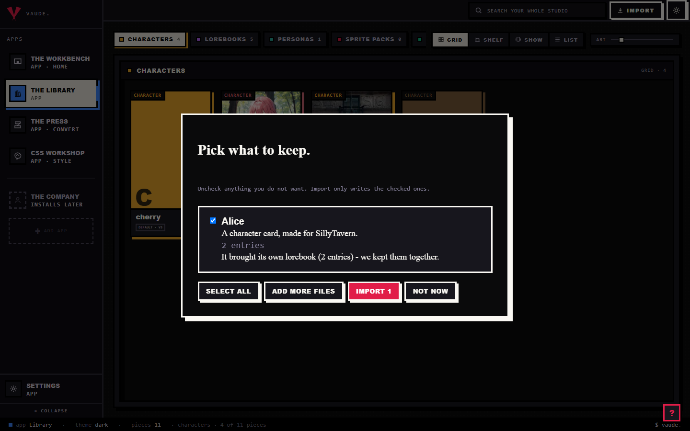
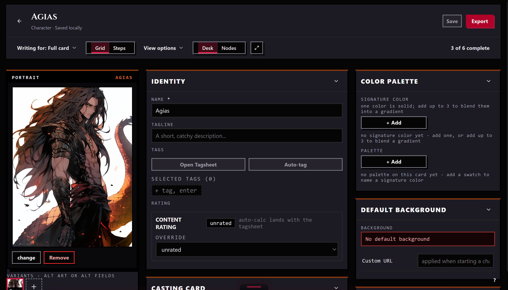
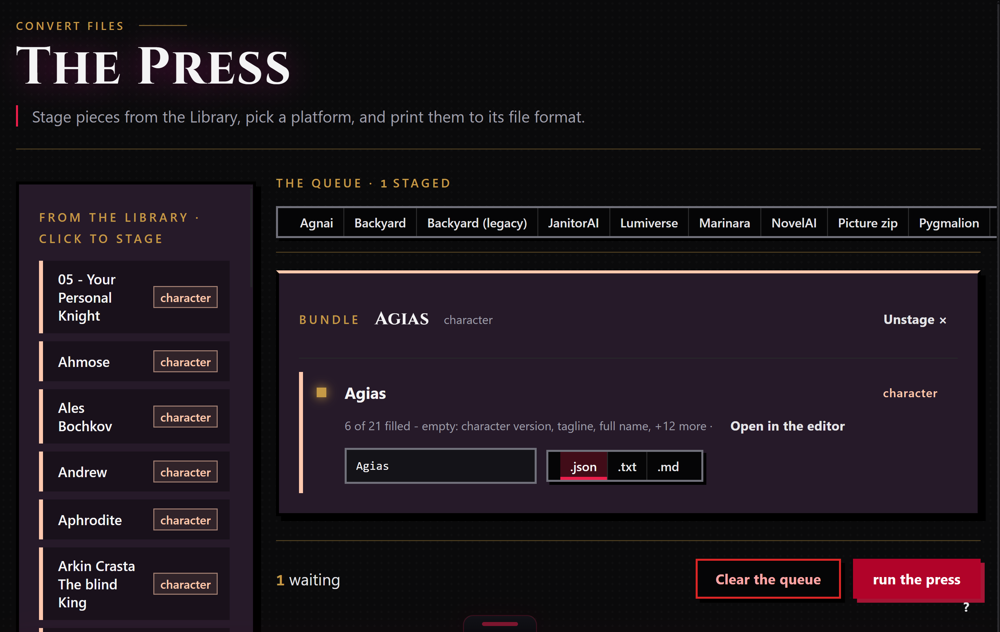

# SillyTavern

SillyTavern is a local app for AI roleplay, and for most people it is where their character cards, worldbooks, and personas live. This page shows you how to bring those files into Bunzai, edit them, and send them back out, whether to SillyTavern again or to another app.

@fig journey

## What Bunzai reads

Bunzai reads the two file types SillyTavern gives you:

- **Character cards**, as a `.png` (the picture is the card, with the character text tucked inside the image) or as a plain `.json` file. Both hold the same thing.
- **Worldbooks** (SillyTavern calls this World Info), as a `.json` file.

To bring one in, drag the file onto the Library and drop it anywhere in the room. Bunzai reads the file and shows you a plain-words receipt: what it read, and what it kept. It recognizes a card by looking inside the file, not by the name, so renaming a card does not confuse it. For the full walkthrough, see [the importing guide](../importing.md).

## What comes across cleanly

Bunzai keeps the original card data alongside the fields you can edit directly:

- Name and description
- Personality and scenario
- First message and any alternate greetings
- Example messages
- System prompt and post-history instructions
- Creator name, creator notes, and tags
- Talkativeness and the linked world name
- An embedded worldbook, with its entries, keywords, and placement

The card's picture is kept too, and Bunzai shows it as the piece's portrait. So after an import, everything that was in the card is still there: the fields above are ready to edit, and the rest is held safely in the background.

## What changes when you convert to another app

This is the honest part, and it is simple once you see the rule.

A same-format export preserves the original card's field values and applies your edits. It does not promise an identical file: JSON formatting and the output container can change. Check the export receipt for unsupported fields when choosing a different format.

Converting to a different app is where things drop. Only the shared character crosses over. SillyTavern's private extras, the settings and scripts that only mean something inside SillyTavern, are left behind on purpose.

| Content | Back to SillyTavern | To another app |
| --- | --- | --- |
| Core character: name, description, personality, scenario, greetings, example messages, system prompt, notes, tags | Kept | Comes across, as far as that app can hold it |
| Embedded worldbook | Kept | Comes across if that app has worldbooks |
| Talkativeness, linked world name | Kept | Comes across if that app has the same setting |
| SillyTavern extension settings, and app add-ons like Chub, Marinara, or Lumiverse | Kept | Dropped |
| Regex scripts (find-and-replace) | Kept | Dropped |
| Internal ids, saved layout, embedding vectors | Kept | Dropped |

"Another app" here means a genuinely different app such as Agnai, Backyard, RoleCall, Risu, or Pygmalion. The drop is deliberate: Bunzai never blind-copies one app's private settings or scripts into another app's file. Your regex stays where it was written, which is where it actually works anyway. And where the other app simply has fewer slots than SillyTavern, whatever it cannot hold is dropped on its side, not yours.

## Editing on the Workbench

Send a piece from the Library to the Workbench and it opens as a tab. There you can edit the name, description, personality, scenario, first message, and example messages. When you save, Bunzai writes the whole card back, so the parts you did not touch stay exactly as they were.

## Exporting back out

When a piece is ready to leave, stage it for the Press: right-click it and choose "Stage for the Press," or drop it in from the Press's own rail. The Press works only the pieces you staged, and each run exports to one target format that you pick.

Bunzai writes SillyTavern cards as `.json`. SillyTavern loads a `.json` card the same as a `.png` one, so it will import fine. If a piece carries an embedded worldbook, it rides along with the character automatically. You can also ask for a plain `.txt` or `.md` copy when you just want to read the text. Choosing a different app as the target applies the drop story above.

## Common questions

- **Will my card come back exactly as it was?** Exporting to SillyTavern preserves the original field values alongside your edits. The output file can use different formatting or a different container, so it need not have identical bytes.
- **I imported a `.png`. Do I get a `.png` back?** Bunzai writes cards as `.json`. SillyTavern reads a `.json` card the same as a picture, so it loads fine, you just get a file instead of an image.
- **Does my character's picture come with it?** Bunzai keeps the card art and shows it as the piece's portrait, and it holds onto the original file you imported.
- **What about my regex scripts?** They stay with the SillyTavern card and are not copied into another app's file, because Bunzai does not move one app's scripts into another.
- **My worldbook was inside the card. Is it still there?** Yes. Bunzai pulls the embedded worldbook out so you can edit it on its own, and puts it back when you export to an app that supports worldbooks.
